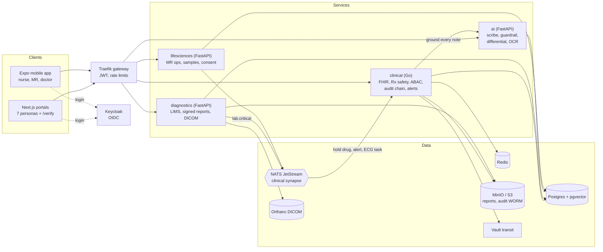

<div align="center">

# OmniMed AI

**One clinical platform for hospitals, labs, pharmacies and life-sciences field teams, where every AI output is grounded before it reaches a patient record.**


[Highlights](#highlights) · [Architecture](#architecture) · [Quick start](#quick-start) · [Personas](#personas) · [Test results](#verified-test-results) · [Deploy](#deploy) · [Roadmap](docs/IMPROVEMENTS.md)

</div>

> [!WARNING]
> This is a reference implementation built on **synthetic data**. It is not a certified medical device and must not be used for real clinical decisions. The default credentials below are for local development only.

---

## Highlights

- **Clinical synapse.** A critical lab value (for example potassium 6.8) reaches the doctor, nurse and pharmacist in under 100 ms, holds the risky drug, opens a STAT ECG task and escalates if nobody responds.
- **Grounded AI.** The ambient scribe, differential and patient explanations pass through a guardrail that rejects any drug, diagnosis or test not present in the source transcript or patient record. The server re-checks every note, so a client cannot bypass it.
- **Safety at the point of care.** Allergy hard stops, drug interactions, dose ranges, barcode eMAR with wrong-patient blocking, and MEWS/qSOFA early-warning scores.
- **Diagnostics.** HL7 v2 and ASTM analyzer ingest, digitally signed PDF reports with public QR verification, and a browser DICOM viewer backed by Orthanc that loads a 500 MB CT series as one volume.
- **Life sciences with compliance built in.** Geofenced medical-rep check-ins, consent-gated e-detailing, and a signed drug-sample ledger.
- **Security by design.** Keycloak OIDC, attribute-based access control across facilities and care teams, Vault envelope encryption for PHI, and a hash-chained audit ledger mirrored to write-once (Object Lock) storage.
- **Interoperable.** FHIR R4 resources and bundles, ICD-10, RxNorm and LOINC coding, and ABDM-style consent flows (simulated).

## Architecture



| Component | Stack | Responsibility |
|---|---|---|
| [`services/clinical`](services/clinical) | Go | Patients, encounters, FHIR R4, prescriptions and safety checks, care teams, ABAC, PHI envelope encryption, audit hash chain, synapse handlers, SSE alerts with tiered escalation |
| [`services/diagnostics`](services/diagnostics) | Python, FastAPI | HL7/ASTM ingest, critical-value detection, signed PDF reports and public verification, Orthanc DICOM proxy, series volume cache, lesion assist |
| [`services/ai`](services/ai) | Python, FastAPI | Rule-based ambient scribe with ICD-10/RxNorm coding, grounding guardrail, differential diagnosis, patient-language results and translation, prescription OCR, optional OpenAI-compatible LLM |
| [`services/lifesciences`](services/lifesciences) | Python, FastAPI | Medical-rep geofencing, e-detailing, doctor consent and slots, signed sample ledger |
| [`apps/web`](apps/web) | Next.js, TypeScript | Persona portals, DICOM viewer, report verification page |
| [`apps/mobile`](apps/mobile) | Expo, React Native | Nurse ward rounds and eMAR scanning, MR field check-in, doctor alerts |
| [`infra`](infra) | Docker Compose, Kustomize, Terraform | Local stack, Kubernetes dev/prod overlays, AWS production infrastructure |
| [`tests`](tests) | pytest | End-to-end tests for the specification's test cases |

## Quick start

**Prerequisites:** Docker Desktop with at least 8 GB of memory. Node.js 20 is needed only for the mobile app.

```bash
git clone https://github.com/Monty25803/omnimed-ai.git
cd omnimed-ai
docker compose -f infra/docker-compose.yml up -d --build
```

The first build takes a few minutes. Then open:

| URL | What |
|---|---|
| http://localhost:3000 | Web portals (pick a persona) |
| http://localhost:8000/api/{clinical,diag,life,ai} | API gateway |
| http://localhost:8080 | Keycloak admin console (`admin` / `admin`) |

Seed data loads on a fresh database. To reset everything, run `docker compose -f infra/docker-compose.yml down -v`.

### Optional configuration

| Variable | Effect |
|---|---|
| `LLM_API_KEY`, `LLM_BASE_URL`, `LLM_MODEL` | Use an OpenAI-compatible LLM for drafts. Output is still grounded; without a key the rule-based engine is used. |
| `WHISPER_URL` | OpenAI-compatible speech-to-text server for the scribe. Without it, transcripts are typed or pasted. |
| `ESCALATION_TIMEOUT_SECONDS` | Seconds before an unacknowledged critical alert escalates (default 120). |

## Personas

Every account's password is `omnimed`.

| Username | Role | Try this |
|---|---|---|
| `dr.rao` | Doctor | Open patient P0001, record an encounter with the scribe, watch the live potassium alert |
| `dr.sen`, `dr.mehta` | Doctor | Other care teams and facilities (useful for access-control checks) |
| `nurse.anita`, `nurse.priya` | Nurse | Ward board, vitals with MEWS, barcode eMAR |
| `pharm.kiran` | Pharmacist | Holds queue, substitutes, in-radius stock |
| `lab.suresh` | Lab | Analyzer ingest, sign reports, DICOM viewer |
| `mr.vikram` | Medical rep | Geofenced check-in, consented detailing, signed samples |
| `patient.lakshmi` | Patient | Results in plain language and Hindi, consents, health locker |
| `admin.audit` | Auditor | Verify the audit chain and WORM mirror |

## Verified test results

Measured on a Windows 11 laptop with the full stack in Docker Desktop. Details are in [docs/IMPROVEMENTS.md](docs/IMPROVEMENTS.md).

| Test case | Target | Result |
|---|---|---|
| TC-SYN-01: critical potassium fan-out | < 500 ms to doctor, nurse, pharmacist | **p95 78 ms**, max 81 ms |
| TC-AI-04: scribe coding accuracy | > 95% ICD-10 and RxNorm | **100%** precision and recall on 20 scripts |
| TC-GRD-02: injected, unsupported terms | 0% saved | **0%**; forged approval flags are rejected |
| TC-DCM-08: 500 MB CT series (1000 slices) | < 2.5 s | **1.0 to 2.0 s** from the gateway, cached volume |
| TC-SEC-12: access control | 403 for unauthenticated and cross-facility | **All pass**; denials audited, chain verified |
| Persona smoke flows | One happy path per persona | **All 7 pass** |

Run the suite yourself:

```bash
# everything except the 500 MB DICOM test (about 15 s)
docker compose -f infra/docker-compose.yml --profile test run --rm tests pytest -q -m "not slow"

# full suite; the first run generates and stores 1000 synthetic CT slices
docker compose -f infra/docker-compose.yml --profile test run --rm tests
```

Results are written to `tests/results/summary.json`. Service unit tests run during each image build.

## Mobile app

```bash
cd apps/mobile
npm install
npx expo start
```

`app.json` points the Android emulator at the host machine (`10.0.2.2:8000` for the gateway and `10.0.2.2:8080` for Keycloak). Change the `extra` block to your machine's LAN address for a physical device.

## Deploy

### Kubernetes

```bash
kubectl apply -k infra/k8s/overlays/dev    # self-contained, in-cluster data services
kubectl apply -k infra/k8s/overlays/prod   # managed data services, secrets from AWS Secrets Manager
```

Both overlays include default-deny NetworkPolicies, non-root containers, resource limits and probes.

### AWS with Terraform

[`infra/terraform`](infra/terraform) provisions, in `ap-south-1` by default:

- A VPC with flow logs, and EKS on Bottlerocket with KMS secrets encryption
- RDS PostgreSQL 16 (Multi-AZ, encrypted, TLS only) and ElastiCache Redis with TLS
- KMS keys with rotation, and S3 buckets (audit bucket in Object Lock compliance mode)
- Secrets Manager entries synced into the cluster by External Secrets

```bash
cd infra/terraform
cp backend.hcl.example backend.hcl   # set your state bucket
terraform init -backend-config=backend.hcl
terraform apply
```

Then install the External Secrets Operator and ingress-nginx, set the role ARN from the `external_secrets_role_arn` output, and apply the prod overlay.

> [!IMPORTANT]
> Read the [security gaps](docs/IMPROVEMENTS.md#security-and-compliance) before any real deployment. In particular, Vault runs in dev mode locally, and the production Keycloak hostname is a placeholder.

## Project structure

```text
.
├── apps/
│   ├── web/              Next.js persona portals and DICOM viewer
│   └── mobile/           Expo app
├── services/
│   ├── clinical/         Go clinical core
│   ├── diagnostics/      FastAPI LIMS and imaging
│   ├── ai/               FastAPI scribe and guardrail
│   ├── lifesciences/     FastAPI MR operations
│   └── common/           Shared Python auth, runtime and synapse client
├── infra/
│   ├── docker-compose.yml
│   ├── postgres/         Schema and synthetic seed data
│   ├── keycloak/         Realm, roles and personas
│   ├── traefik/          Gateway routes
│   ├── k8s/              Kustomize base, components and overlays
│   └── terraform/        AWS production infrastructure
├── tests/                End-to-end specification tests
└── docs/IMPROVEMENTS.md  Results, known gaps and roadmap
```

## Roadmap

Known gaps and suggested next features, prioritised by patient safety, are in [docs/IMPROVEMENTS.md](docs/IMPROVEMENTS.md). Highlights:

- Licensed SNOMED CT, RxNorm and LOINC releases instead of the bundled demonstration vocabulary
- Live ABDM sandbox integration, an SMS provider, and a validated handwriting OCR model
- Serving imaging directly from the gateway or signed storage URLs, bypassing the Next.js proxy
- Medication reconciliation, a sepsis bundle tracker, antimicrobial stewardship, and an offline-first mobile eMAR

## Disclaimer

All patients, clinicians and records in this repository are synthetic. Clinical rules, thresholds and vocabularies are for demonstration and have not been clinically validated.
